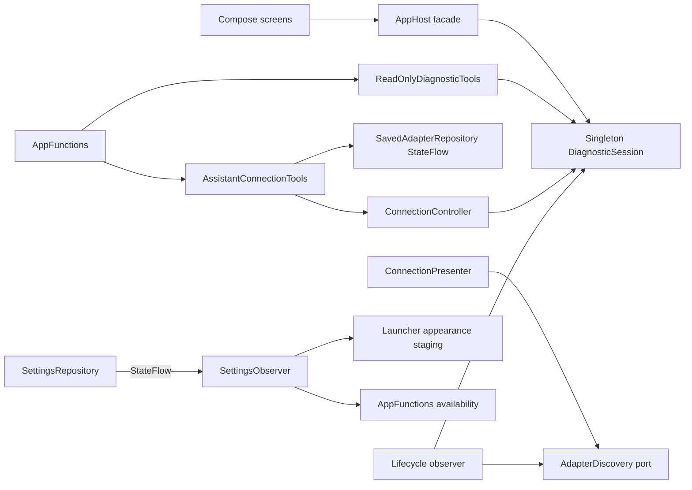

# Dependency injection and application boundaries

Koin 4.2.2 provides the composition roots. The diagnostic engine stays independent of Koin, Android and Compose.

- `composeApp/.../di/SharedModule.kt` binds the session, read-only tools, bundled-resource cache, settings observer, UI facade and presenter factories.
- `androidApp/.../di/AndroidModule.kt` supplies Android repositories, permission requests, discovery, transport providers, connection lifetime, AI availability and lifecycle handling.
- `EcuVueApplication` starts the graph and attaches observers. `MainActivity`, `DiagnosticConnectionService` and the generated AppFunctions service resolve dependencies at their framework entry points.
- Desktop and iOS preview entry points use the shared module with memory storage and simulator connections. Native iOS transports/App Intents are still separate future work.

## Responsibilities and substitution

`ApplicationPorts.kt` defines narrow contracts for settings, references, discovery, connection commands, adapter creation, launcher appearance and AI availability. Android implementations receive their dependencies through constructors. Screen functions receive state and actions; Settings does not depend on an Android host, and the connection presenter depends only on discovery and its coroutine scope.

Persistence belongs to `AndroidSettingsRepository` and `AndroidSnapshotStore`. Permission handling belongs to `AndroidPermissions` and the owner-aware `ActivityBridge`. Discovery belongs to `AndroidAdapterDiscovery`. `AndroidConnectionController` coordinates the connection's foreground-service/USB-detach lifetime. `ElmAdapterFactory` wraps the transport selected from the composition root's provider registry; replacing a transport does not require editing the controller or UI.

The former large UI file is split into Overview, Diagnostics, Live Data, Connections, Settings, reference/detail screens, theme and shared components. Navigation and transient form state remain in Compose. `ConnectionPresenter` owns asynchronous discovery, cancellation, duplicate removal and errors, exposing immutable snapshots through StateFlow.

## Lifetimes and observers

The session, settings, report store, reference cache, tools and native gateways are application singletons. UI and assistants share the same operation mutex and connection. Assistants remain opt-in and read-only; no new exported functions or raw-command entry points were introduced.

The connection presenter is a factory bound to its screen's coroutine lifetime. Leaving the screen cancels discovery without cancelling the application scope or disconnecting the active vehicle. Activities attach permission/back callbacks with an owner token; destroying an older Activity cannot detach its replacement.

`SettingsObserver` has independent distinct flows for appearance and AI opt-in. AI synchronization uses `collectLatest`, so an older enable operation cannot finish after a newer revocation. The read-only tools still check the repository's current opt-in immediately, independently of asynchronous OS indexing. `DiagnosticLifecycleObserver` controls foreground polling, discovery cleanup and background-only launcher switching. There is no custom Java Observable/event bus.

The application scope is cancelled when its Koin definition closes. Desktop closes the container on exit; Android services and UI callbacks retain their own shorter lifetimes.

`ReferenceCatalog` starts from the application composition root and loads on `Dispatchers.Default`. Its `StateFlow<CatalogState>` is the observer contract: `Loading`, `Ready` with a fully parsed catalog, or `Failed` with a retry action. Compose observes this singleton without awaiting the catalog; only offline search and reference credits require readiness. Fault lists, navigation and connections remain usable, and descriptions update when the catalog arrives. Concurrent load requests are coalesced and successful loads are retained across Activity recreation. The bundled-resource cache uses separate locks for the catalog, translations and manufacturer data, so background catalog loading cannot block UI translations or adapter identification. Assistant lookups can still suspend on the shared catalog cache without blocking the UI thread.

## Verification

Tests cover graph singleton identity and tool consent, injected transport selection, relevant settings notifications, stale enable cancellation, discovery cancellation and error retention, and Activity bridge ownership. Emulator tests cover the complete UI, Activity recreation without losing the session, and real Android AppFunctions execution with the Activity stopped. See [validation](VALIDATION.md) for results and hardware/iOS verification limits.

Koin references: [setup and versions](https://insert-koin.io/docs/setup/), [starting outside Compose](https://insert-koin.io/docs/reference/koin-compose/compose/), [classic module definitions](https://insert-koin.io/docs/reference/koin-core/starting-koin/).

Saved-adapter reconnection is a separate port from read-only diagnostic operations. `AndroidSavedAdapterRepository` persists only successful user selections; approval is tied to device identity and reset when devices change. `AssistantConnectionTools` checks global consent and per-device approval, accepts no remote address, and reuses an existing session. The Android connection controller serializes manual/assistant connection attempts, preflights permissions without background prompts, starts the connected-device service, and reports foreground setup requirements. Session authorization is rechecked before and after the handshake; revoking approval during the handshake closes that new connection. USB profiles use vendor/product/serial rather than a recycled Android device ID. Profiles without a serial remain manual-only.

`ConnectionServiceLauncher` awaits the service's `onStartCommand` acknowledgement, after `startForeground` in `onCreate`, before the adapter handshake. This prevents fast handshake failures from stopping an unpromoted foreground service and crashing the process. Background start denial is reported before opening the transport.
